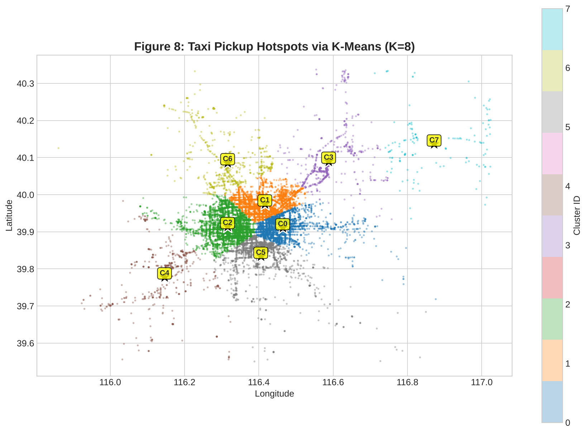
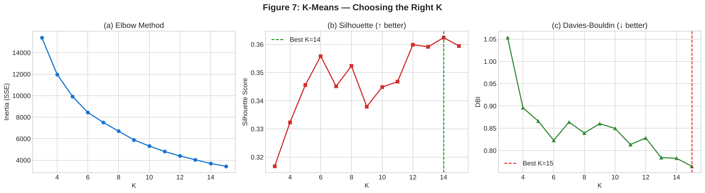
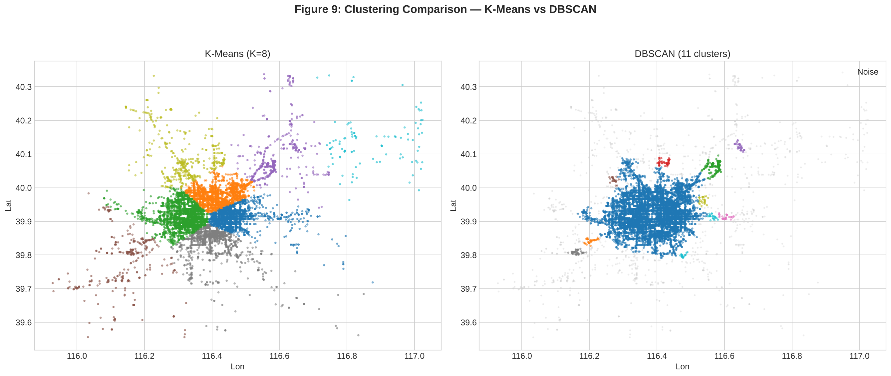
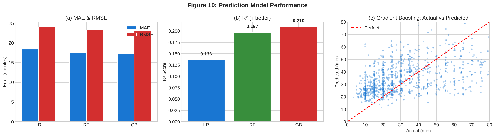
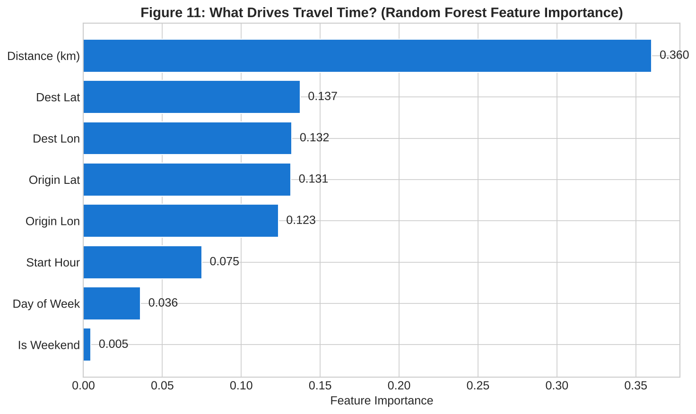
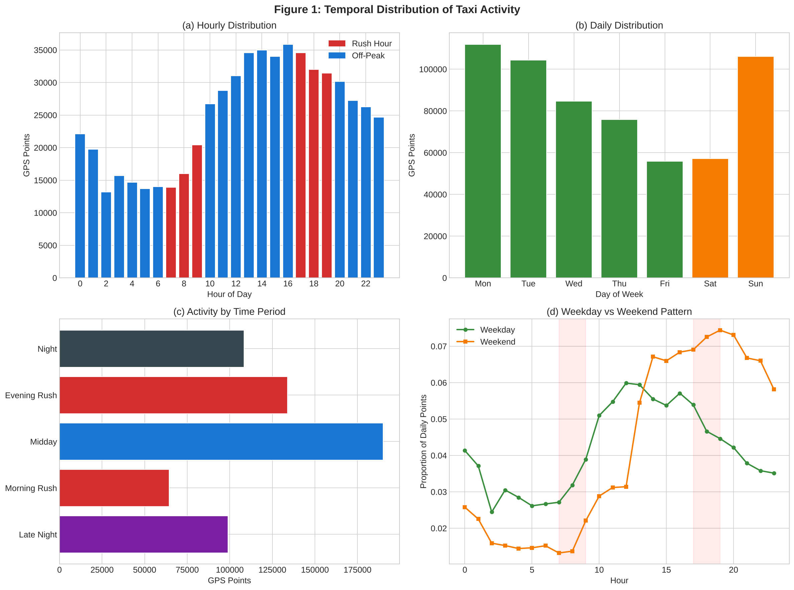
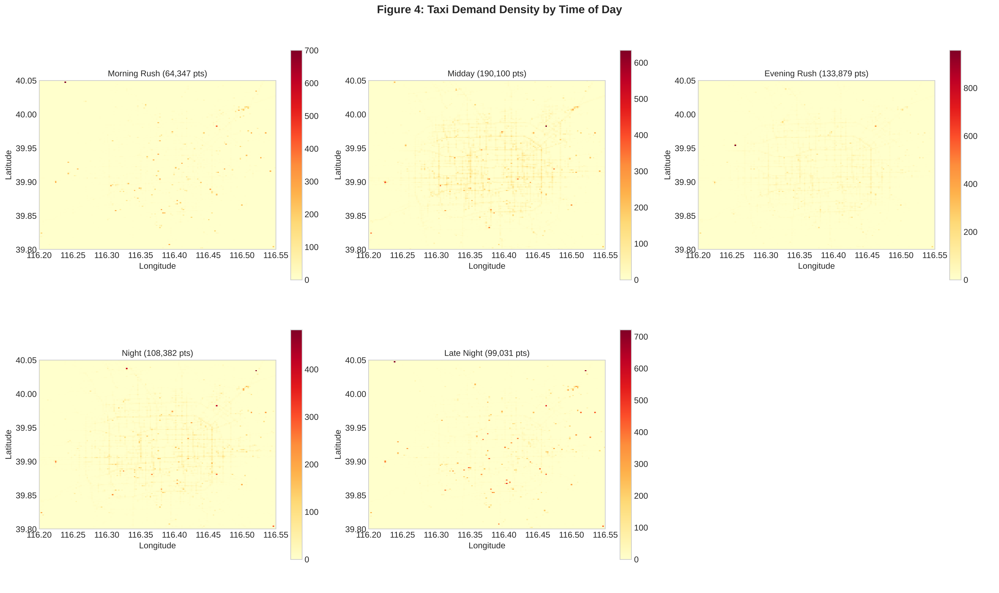

# Beijing Taxi Demand

Where taxi demand concentrates in Beijing, and how long a trip takes. Built on T-Drive, a week
of GPS traces from Beijing taxis, this notebook cleans the raw traces, reconstructs trips,
clusters pickup locations into hotspots, and trains regression models to predict trip duration.



## Data

500 taxi files from T-Drive (three of them empty), covering February 2–8, 2008.

| Stage | Records |
|---|---|
| Raw GPS points | 628,818 from 497 taxis |
| After cleaning | 595,739 (5.26% removed) |
| Trips extracted | 14,953 |

Cleaning runs in three layers: a bounding box around greater Beijing (845 points removed), a
speed filter for segments implying more than 200 km/h (826 removed), and a 3σ rule on each
coordinate (31,408 removed). Trips are cut from the continuous stream wherever a taxi is idle
for more than five minutes, and kept only when they last 1–180 minutes and span 0.5–100 km.

## Hotspot clustering

K-Means over pickup coordinates, with K swept from 3 to 15 and scored by inertia, silhouette
and the Davies-Bouldin index.



The scores are nearly flat across the whole range: silhouette moves only between 0.317 and
0.362, peaking at K=14, while Davies-Bouldin keeps improving up to K=15. Neither metric shows a
clear optimum, so the choice of **K=8** is a judgement call, taken for interpretability — eight
zones that map onto recognisable parts of the city — rather than something the metrics select.
The largest three clusters hold 11,025 of the 14,953 trips and sit in central Beijing; the
outer clusters are smaller and have longer, faster trips.

DBSCAN was run as a contrast, since it needs no K and labels noise. On a 10,000-trip sample it
found 11 clusters and marked 10.4% of the points as noise. It scores far lower on silhouette
(0.008 against 0.343) because it carves out dense, irregular cores rather than the compact,
balanced partitions silhouette rewards.



## Travel time prediction

Trip duration regressed on origin and destination coordinates, straight-line distance, departure
hour, day of week and a weekend flag. 80/20 split, 11,418 training trips.

| Model | MAE (min) | RMSE (min) | R² |
|---|---|---|---|
| Linear Regression | 18.41 | 24.11 | 0.136 |
| Random Forest | 17.59 | 23.25 | 0.197 |
| **Gradient Boosting** | **17.35** | **23.07** | **0.210** |

Five-fold cross-validation of the Random Forest gives 17.76 ± 0.60 minutes, consistent with the
held-out result, so the models are stable — just weak. **An error of 17 minutes on trips that
average 40 minutes is not useful in practice.** The tree ensembles beat linear regression, which
says the relationship is non-linear, but all three explain little of the variance.

The reason is visible in the feature importances: straight-line distance dominates, and it is a
poor proxy for travel time when the "trips" here are segments cut by a five-minute idle gap
rather than real metered rides. A trip that circles back ends up with a short straight-line
distance and a long duration. Road-network distance via map matching, plus traffic state at
departure, are what this model is missing.





## Temporal and spatial patterns



Weekday activity is bimodal, peaking in the morning and evening commutes; weekends start later
and stay flatter. Demand concentrates sharply in central Beijing and thins out toward the
suburbs.



## Run it

```bash
pip install -r requirements.txt
jupyter notebook tdrive_taxi_analysis.ipynb
```

T-Drive is not redistributed here. Download it from
[Microsoft Research](https://www.microsoft.com/en-us/research/publication/t-drive-trajectory-data-sample/)
or [urban-computing.com](http://urban-computing.com/index-58.htm), then extract the per-taxi
`.txt` files into `data/taxi_log_2008_by_id/`. The notebook reads the first 500 files; the run
recorded here took about fifteen minutes.

## Limitations

- The data is from 2008, before Beijing's subway expansion and before ride-hailing.
- Trips are segmented by an idle-gap heuristic, not by meter events, so they are approximations
  of real rides.
- No external signals (weather, holidays, incidents) and no road-network distance.
- Only 500 of the 10,357 available taxis are loaded.

## Context

Group project for *Data Science and Algorithms*, Beijing Institute of Technology, spring 2026.

## References

1. J. Yuan, Y. Zheng, et al. "T-Drive: Driving Directions Based on Taxi Trajectories." ACM SIGSPATIAL GIS, 2010.
2. Y. Zheng. "Trajectory Data Mining: An Overview." ACM TIST, 6(3), 2015.
